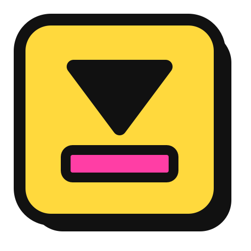
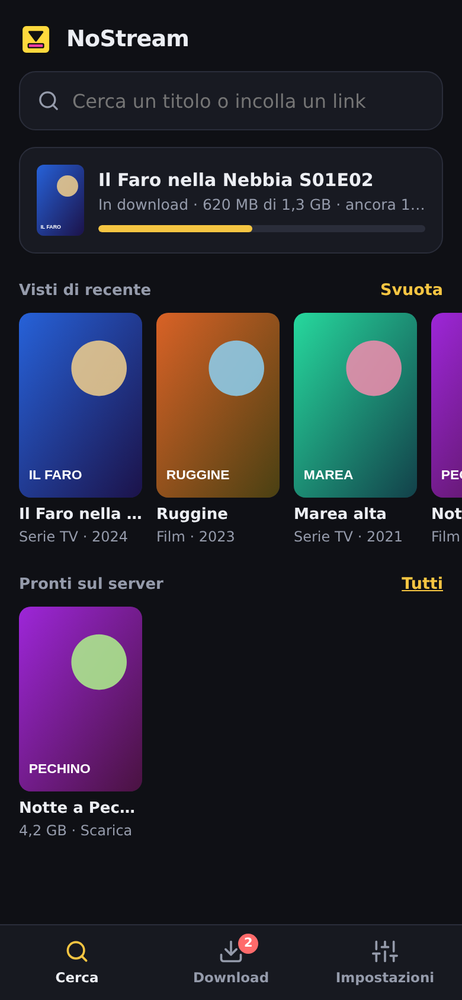
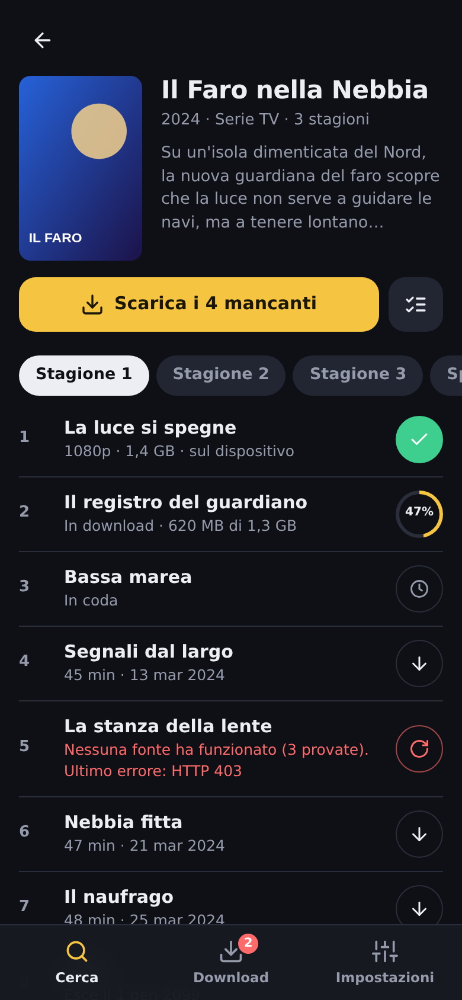
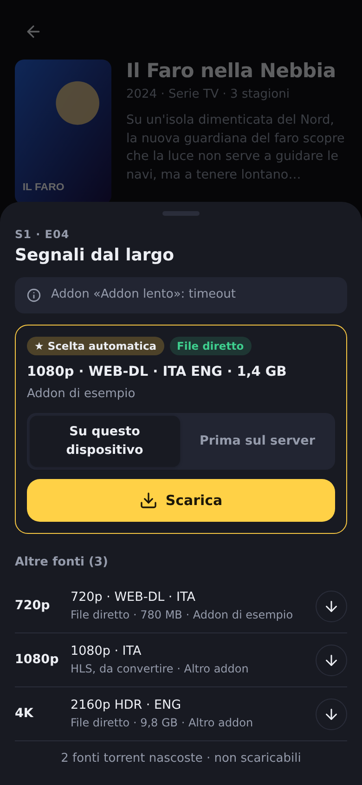
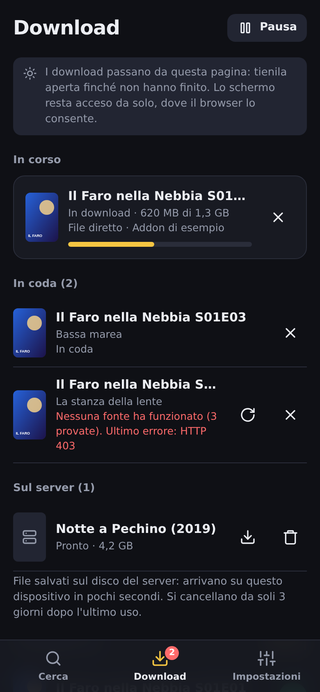
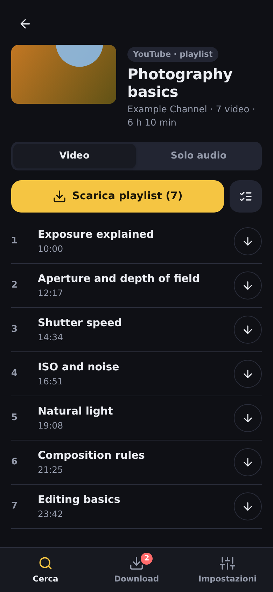

<p align="center">
  
</p>

<h1 align="center">NoStream</h1>

<p align="center"><b>Scarica invece di streamare.</b><br>
Downloader self-hosted per le fonti di Stremio/Nuvio, i plugin di Nuvio e i link video.<br>
<sub><a href="README.md">English</a> · Italiano</sub></p>

NoStream trova film e serie tramite gli addon Stremio e i plugin di Nuvio che usi già, e
trasforma i loro stream in **file salvati sul tuo dispositivo**, da guardare senza
connessione: in aereo, in treno, all'estero. Scarica anche video e playlist intere da
YouTube e dagli altri siti supportati da yt-dlp.

Gira **sul tuo server** (Docker: NAS, Raspberry Pi, mini PC) oppure **su un PC Windows come
programma portable** (estrai lo zip e doppio clic, niente da installare). Lo usi:

- **dal browser**, su qualsiasi telefono, tablet o computer: cerchi, tocchi ↓, fatto;
- **dentro [Nuvio](https://github.com/NuvioMedia/NuvioMobile)**, come addon: accanto agli
  stream di sempre compaiono le voci di NoStream, che il download di Nuvio salva sul telefono.

<p align="center">
  
  
  
  
  
</p>
<p align="center"><sub>Titoli, locandine e playlist sono inventati per la demo. Tema scuro e chiaro, interfaccia in 5 lingue.</sub></p>

> **Uso previsto**: scarica solo contenuti che hai il diritto di vedere e tenere. NoStream
> non fornisce contenuti propri: interroga gli addon, i plugin e i link che configuri *tu* e
> fa da proxy o converte ciò che indicano.

---

## Indice

- [Funzioni](#funzioni)
- [Installazione](#installazione): [Docker](#docker) · [Docker Compose](#docker-compose) · [CasaOS / ZimaOS](#casaos--zimaos) · [Windows portable](#windows-portable) · [Da sorgente](#da-sorgente)
- [Primo avvio](#primo-avvio)
- [Fonti](#fonti): [addon](#addon-stremio) · [account Nuvio](#il-tuo-account-nuvio) · [plugin di Nuvio](#plugin-di-nuvio) · [video da link](#video-da-link-youtube-e-altri)
- [Scaricare](#scaricare)
- [Usarlo dentro Nuvio](#usarlo-dentro-nuvio)
- [Raggiungerlo fuori casa](#raggiungerlo-fuori-casa)
- [Configurazione](#configurazione)
- [Aggiornamento](#aggiornamento)
- [Limiti noti](#limiti-noti)
- [Per sviluppatori](#per-sviluppatori)
- [Licenza](#licenza)

---

## Funzioni

- **Un tocco per scaricare.** Ogni episodio ha un pulsante che ne mostra lo stato: ↓, in
  coda, anello di avanzamento, ✓ fatto, ↻ riprova. "Scarica stagione" mette in coda tutto
  quello che manca.
- **Scelta automatica della fonte** secondo le tue preferenze (lingua audio, file diretti
  prima degli HLS, qualità preferita). L'elenco completo è a un tocco, per scegliere a mano.
- **Due destinazioni**: direttamente *su questo dispositivo*, oppure *prima sul server*: il
  server scarica a piena velocità sul suo disco, poi il file arriva al dispositivo in pochi
  secondi.
- **Una sola pagina Download**: avanzamento, coda, nuovi tentativi, file sul server e storico.
- **Il tuo account Nuvio**: accedi una volta e NoStream usa gli addon che hai installato in
  Nuvio, tenendoli allineati. Solo in lettura.
- **Plugin di Nuvio** (scraper locali), eseguiti sul server in un processo chiuso.
- **Video da link**: YouTube e gli altri siti di yt-dlp, video singoli o playlist intere,
  video o solo audio (m4a/mp3/opus).
- **Due addon per Nuvio**: *Streaming* dà un solo link per risoluzione, verificato e
  funzionante, da guardare subito; *Download* dà le voci da scaricare con Nuvio stesso.
- **Primo avvio guidato**, **tema scuro e chiaro**, **5 lingue** (italiano, inglese,
  spagnolo, francese, tedesco), su telefono e computer.

## Installazione

Serve una **API key TMDB gratuita**, usata per la ricerca e per stagioni ed episodi:

1. crea un account su <https://www.themoviedb.org/signup>;
2. vai su <https://www.themoviedb.org/settings/api> e richiedi una chiave "Developer"
   (uso non commerciale, gratuita);
3. copia la "API Key (v3 auth)": NoStream te la chiede al primo avvio.

Serve anche almeno una fonte: addon Stremio con stream **HTTP** (non torrent), il tuo
account Nuvio, oppure semplicemente dei link video.

### Docker

L'immagine è pubblica e già pronta (`amd64` e `arm64`), non serve compilare nulla.

```bash
mkdir nostream && cd nostream
# config.json deve esistere come FILE prima dell'avvio, altrimenti Docker crea una cartella
echo '{}' > config.json
mkdir data

docker run -d --name nostream --restart unless-stopped \
  -p 4321:4321 \
  -v "$(pwd)/config.json:/app/config.json" \
  -v "$(pwd)/data:/app/data" \
  ghcr.io/katergaris/nuviodl:latest
```

Poi apri `http://<ip-del-server>:4321`.

- `config.json` contiene impostazioni, fonti e accesso a Nuvio.
- `data/` contiene i file preparati sul server, i video da link e gli aggiornamenti di yt-dlp.

> Il nome dell'immagine `nuviodl` è storico (NoStream si chiamava NuvioDL): resta uguale
> perché le installazioni esistenti continuino ad aggiornarsi.

### Docker Compose

```bash
git clone https://github.com/katergaris/NoStream.git
cd NoStream
cp config.example.json config.json
docker compose up -d
```

Il [`docker-compose.yml`](docker-compose.yml) usa l'immagine pubblicata e monta
`config.json` e `data/`. Per compilare dal sorgente decommenta `build: .` e usa
`docker compose up -d --build`.

### CasaOS / ZimaOS

**App Store → Custom Install** (Installa app personalizzata), incolla il contenuto di
[`docker-compose.yml`](docker-compose.yml) e fai puntare i volumi a un file `config.json`
già creato e a una cartella dati (es. `/DATA/AppData/nostream/config.json` e
`/DATA/AppData/nostream/data`).

### Windows portable

1. Scarica `NoStream-<versione>-windows-x64.zip` dalla pagina
   [Releases](https://github.com/katergaris/NoStream/releases).
2. Estrailo in una cartella dove puoi scrivere: Documenti, Desktop, un altro disco, una
   chiavetta. Non in `C:\Programmi`.
3. Doppio clic su **`NoStream.exe`**: si apre il browser su NoStream. Chiudendo la
   finestrina NoStream si ferma.

Node, ffmpeg e yt-dlp sono già dentro. Impostazioni e dati restano nella cartella e niente
viene scritto altrove; per disinstallare basta cancellarla.

La prima volta Windows può mostrare:
- **"PC protetto da Windows"** (SmartScreen): l'exe non è firmato. Tocca *Ulteriori
  informazioni → Esegui comunque*.
- **Accesso alla rete**: scegli **Reti private**, così il telefono raggiunge il PC.

Per aggiornare si sostituiscono `NoStream.exe` e la cartella `app\`. Dettagli nel
[LEGGIMI.txt](packaging/windows/LEGGIMI.txt) che trovi nello zip.

### Da sorgente

```bash
git clone https://github.com/katergaris/NoStream.git
cd NoStream
npm install --omit=dev
cp config.example.json config.json
node server.js
```

Serve Node.js 22 o più recente, con `ffmpeg` nel PATH. Facoltativi `yt-dlp` e Python 3,
per i video da link.

## Primo avvio

NoStream ti accompagna in tre passi:
1. **key TMDB**, verificata subito;
2. **fonti**: incolli l'URL del manifest di un addon, oppure prendi gli addon dal tuo
   account Nuvio;
3. **Nuvio** (facoltativo): l'URL per installare NoStream come addon, con pulsante Copia.

## Fonti

### Addon Stremio

**Impostazioni → Fonti → Addon**: incolli l'URL del `manifest.json` e il nome viene letto
dal manifest. Per ogni addon vedi se risponde e quanto è veloce. NoStream li interroga
tutti in parallelo, unisce i link doppi e scarta i torrent.

Alcuni addon "scraper" non danno uno stream ma una pagina (`externalUrl`). NoStream la
risolve lato server per MixDrop (`gx`), StreamingCommunity/vixsrc (`css`), Altadefinizione
(`dd`), StreamHG (`sp3`) e VOE (`voe`). Le voci dei provider non supportati non compaiono.

### Il tuo account Nuvio

**Impostazioni → Fonti → Account Nuvio**: accedi con email e password di Nuvio.
- NoStream legge gli addon installati nel tuo account, per il profilo scelto.
- Usa come fonti quelli che danno stream di film e serie.
- Salta cataloghi, sottotitoli, NoStream stesso, addon disattivati e doppioni, e per ognuno
  dice il motivo.
- Rilegge l'elenco ogni 6 ore: un addon aggiunto in Nuvio compare qui da solo.
- Puoi spegnere ogni addon che non vuoi usare.

La password non viene salvata: NoStream conserva solo un gettone di accesso, che si
revoca scollegando l'account. NoStream **non scrive mai** nel tuo account Nuvio.

### Plugin di Nuvio

Anche i plugin di Nuvio (scraper locali: piccoli programmi JavaScript presi da repository
di plugin) vengono letti dal tuo account. Si accendono in **Account Nuvio → Plugin di
Nuvio** e all'inizio **sono spenti**.

I plugin sono codice scritto da terzi, quindi NoStream li esegue in un **processo
separato e chiuso** (permission model di Node.js):
- non può leggere né scrivere file del server (impostazioni, chiavi, download);
- non può avviare altri programmi;
- può solo usare la rete;
- riceve lo stesso ambiente che ha nell'app Nuvio (`fetch`, `cheerio`, `crypto-js`, l'id
  TMDB del titolo e la tua key TMDB).

Ogni plugin ha il suo interruttore e mostra l'esito dell'ultima ricerca. I plugin per
anime e cartoni si usano solo per i titoli che TMDB classifica come animazione: sugli altri
tendono a trovare il video sbagliato.

### Video da link (YouTube e altri)

Incolla un link nella barra di ricerca: un video o una playlist intera, da YouTube o da uno
qualsiasi dei [siti supportati da yt-dlp](https://github.com/yt-dlp/yt-dlp/blob/master/supportedsites.md).
Si apre una pagina come quella di una serie: scegli **Video** o **Solo audio**, poi scarichi
tutto, una selezione o un elemento solo.

Il server scarica con yt-dlp e unisce video e audio con ffmpeg (H.264/AAC dove esiste, così
il file si apre ovunque), poi il file arriva al dispositivo.

In **Impostazioni → Download → Video da link** trovi qualità massima, formato audio,
sottotitoli incorporati, numerazione dei file e aggiornamenti di yt-dlp. YouTube cambia
spesso, quindi NoStream aggiorna yt-dlp da solo all'avvio e una volta al giorno, senza
ricostruire nulla.

## Scaricare

- **Tocca ↓** su un episodio, un film o un video: NoStream sceglie la fonte migliore
  secondo le tue preferenze (**Impostazioni → Download**) e, se fallisce, prova la
  successiva.
- **Tocca la riga** per vedere tutte le fonti e scegliere tu.
- **Destinazione**:
  - *su questo dispositivo* passa il file al browser man mano;
  - *prima sul server* (solo file diretti) lo scarica a piena velocità sul disco del server,
    poi lo passa al dispositivo in pochi secondi.

  I file sul server si cancellano 3 giorni dopo l'ultimo uso, e NoStream lascia sempre
  almeno 1 GB libero.
- **Stream HLS** (`.m3u8`): il server li converte con ffmpeg in MPEG-TS mentre scaricano.
  La ripresa funziona.
- **La coda lavora nel browser**: tieni aperta la pagina Download finché non ha finito (lo
  schermo resta acceso da solo, dove il browser lo consente). La prima volta consenti i
  *download multipli* quando il browser lo chiede.

## Usarlo dentro Nuvio

NoStream offre **due addon**: installa quello che ti serve, o entrambi. **Impostazioni →
Installa in Nuvio** mostra i due URL (nella versione Windows con l'indirizzo del PC in
rete). In Nuvio vai in **Impostazioni → Addon** e incollali.

### ▶ Streaming: `/watch/manifest.json`

Per ogni film o episodio trovi **un solo link per risoluzione** (4K, 1080p, 720p, 480p),
scelto tra tutte le tue fonti e **provato prima di mostrarlo**: NoStream legge i primi
byte del video (file diretti) o la playlist e il primo segmento (HLS), e tiene solo i
link che restituiscono davvero un video. Prima la tua lingua audio. La riproduzione passa
da NoStream, così la fonte riceve esattamente la richiesta che è stata provata (header,
IP del server); per gli HLS passano da NoStream anche i segmenti. I risultati restano in
memoria 10 minuti.

### ⬇️ Download: `/manifest.json`

Cerca un titolo come sempre. Tra gli stream trovi le voci di NoStream:
   - **⬇️ Scaricabile**: file diretto, velocità piena, con dimensione e ripresa;
   - **🔄 Da convertire**: HLS, convertito sul server;
   - **📦 Prepara sul server**: lo scarica prima sul server; poi la voce diventa
     **✅ Pronto sul server** e arriva sul telefono in pochi secondi.
4. **Tieni premuta** una voce e scegli **Scarica**. I download sono in *Libreria → icona di
   download*.

## Raggiungerlo fuori casa

NoStream **non ha login**: chiunque raggiunga la porta può cercare e scaricare. Non
esporlo direttamente su Internet. Usa invece:
- una **VPN** (Tailscale, WireGuard, ZeroTier);
- oppure un **reverse proxy con autenticazione** (Caddy, Nginx, Traefik).

Dietro un proxy HTTPS (anche `tailscale serve`) NoStream genera link `https://` leggendo
`X-Forwarded-Proto` (per gli host `*.ts.net` lo fa sempre). Assicurati che il proxy inoltri
questo header.

## Configurazione

Tutto si cambia dalle **Impostazioni**; il `config.json` lo scrive NoStream.

| Campo | Default | Descrizione |
|---|---|---|
| `tmdbApiKey` | `""` | API key v3 di TMDB |
| `language` | `it-IT` | Lingua di titoli e trame (`it-IT`, `en-US`, `es-ES`, `fr-FR`, `de-DE`) |
| `port` | `4321` | Porta HTTP |
| `concurrentDownloads` | `2` | Conversioni HLS contemporanee (i file diretti non hanno limite) |
| `addonTimeoutMs` | `60000` | Attesa massima per ogni addon/plugin; più basso = lista più veloce |
| `addons` | `[]` | Fonti (`name`, `manifestUrl`; `origin: "nuvio"` per quelle del tuo account) |
| `ytdlp` | | `maxHeight`, `audioFormat`, `embedSubs`, `numberFiles`, `autoUpdate` |
| `nuvio` | | Accesso a Nuvio (gettone, profilo, addon esclusi, plugin). Da tenere privato |

La **lingua dell'interfaccia** e le **preferenze di download** si salvano per dispositivo,
nel browser.

Variabili d'ambiente:

| Variabile | Uso |
|---|---|
| `CONFIG_PATH` | Percorso di `config.json` |
| `DATA_DIR` | Cartella dei dati (default `data/` accanto al programma; `/app/data` in Docker) |
| `YTDLP_PATH` | yt-dlp da usare finché non c'è una copia aggiornata in `data/bin` |
| `NUVIO_BACKEND` | URL del backend di Nuvio (default `https://api.nuvio.tv`, es. per un Nuvio self-hosted) |

## Aggiornamento

**Docker**:

```bash
docker pull ghcr.io/katergaris/nuviodl:latest
docker compose up -d        # oppure rimuovi e ricrea il container come sopra
```

Su CasaOS/ZimaOS il pulsante di aggiornamento non sempre ricrea il container quando cambia
solo l'immagine `latest`: dopo il `docker pull` riapplica il compose dell'app.

**Windows portable**: sostituisci `NoStream.exe` e `app\`.

## Limiti noti

- **Nessuna autenticazione integrata** (vedi [sopra](#raggiungerlo-fuori-casa)).
- **Torrent/magnet non supportati**: servirebbe un client BitTorrent.
- **HLS**: dimensione e percentuale si conoscono solo a conversione finita.
- **CDN legati all'IP**: alcune fonti firmano il link per l'IP di chi lo ha chiesto. Per i
  file diretti NoStream ripiega rimandando il client alla fonte; per gli HLS non c'è
  alternativa.
- **Nuvio aspetta la fonte più lenta**: il protocollo degli addon prevede una sola risposta,
  quindi Nuvio mostra le voci di NoStream solo quando tutte le fonti hanno risposto o sono
  scadute. Se è lento abbassa `addonTimeoutMs`.
- **Download in Nuvio che si mettono in pausa (Android 14+)**: il download di Nuvio si
  ricollega spesso e dopo 4 interruzioni si ferma; tocca *Riprendi* nella schermata Download
  di Nuvio, senza perdere nulla. Con *Prepara sul server* non succede, e nemmeno con la
  pagina Download della web app.
- **Account e plugin di Nuvio** usano il backend di Nuvio, che non è un'interfaccia pubblica
  documentata: se Nuvio la cambia, la lettura si ferma finché NoStream non si aggiorna.
  NoStream tiene l'ultimo elenco letto.
- **Plugin**: alcuni, scritti per l'app Nuvio, possono non funzionare fuori dall'app;
  NoStream segna quelli che falliscono.
- **Windows portable**: non firmato (avviso SmartScreen); il PC deve restare acceso per
  usarlo dal telefono.

## Per sviluppatori

Struttura, API, compilazione della versione Windows e istruzioni per aggiungere una
lingua sono nella [sezione Developers del README in inglese](README.md#developers).

In breve, per le traduzioni: ogni testo, compresi quelli del server (chiavi `srv.*`), sta
in `public/i18n/<lingua>.json`. L'italiano è la lingua di riferimento.

## Licenza

[MIT](LICENSE) © 2026 katergaris. Il software è fornito "così com'è", senza garanzie: chi lo
installa è responsabile dell'uso che ne fa e dei contenuti che scarica. Lo zip per Windows
contiene [ffmpeg](https://ffmpeg.org) (LGPL), [Node.js](https://nodejs.org) e
[yt-dlp](https://github.com/yt-dlp/yt-dlp) (Unlicense), ognuno con la sua licenza.
