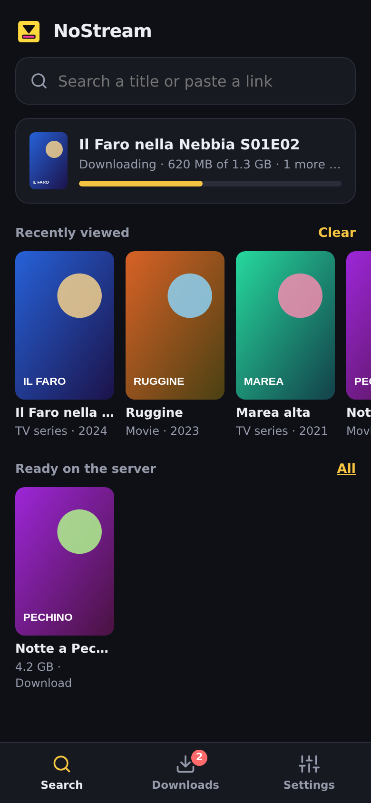
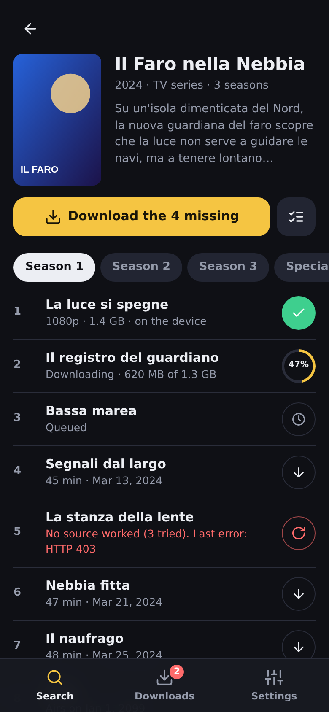
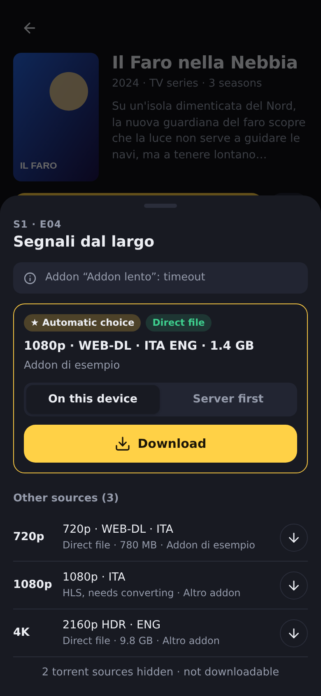
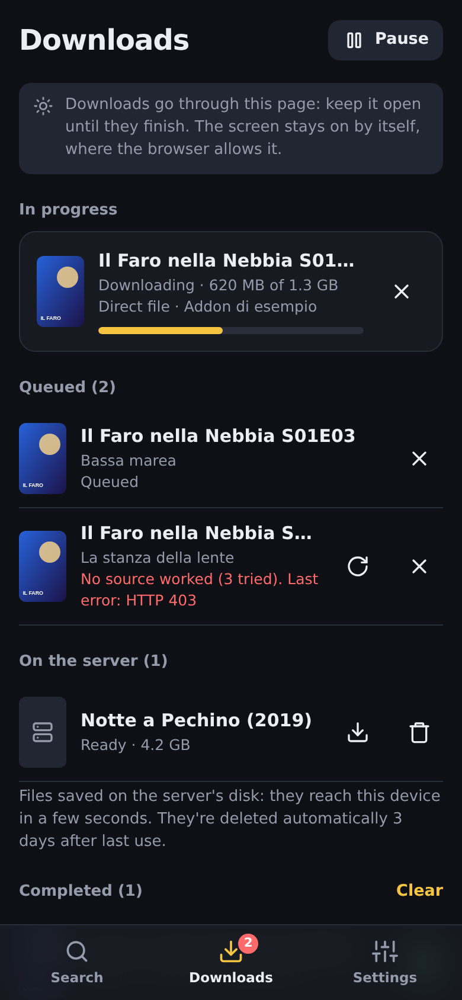
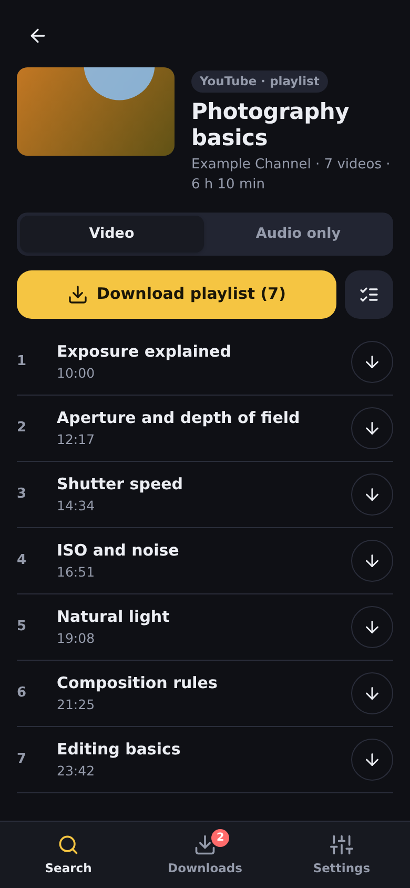

<p align="center">
  
</p>

<h1 align="center">NoStream</h1>

<p align="center"><b>Download instead of streaming.</b><br>
Self-hosted downloader for Stremio/Nuvio sources, Nuvio plugins and video links.<br>
<sub>English · <a href="README.it.md">Italiano</a></sub></p>

NoStream finds movies and series through the Stremio addons and Nuvio plugins you
already use, and turns their streams into **files saved on your device**, so you can
watch them offline: on a plane, on a train, abroad. It also downloads videos and whole
playlists from YouTube and the other sites supported by yt-dlp.

It runs **on your own server** (Docker: NAS, Raspberry Pi, mini PC) or **on a Windows
PC as a portable app** (unzip and double-click, nothing to install). You use it:

- **from the browser**, on any phone, tablet or computer: search, tap ↓, done;
- **from inside [Nuvio](https://github.com/NuvioMedia/NuvioMobile)**, as an addon: next to
  the usual streams you get NoStream entries that Nuvio's own downloader saves on the phone.

<p align="center">
  
  
  
  
  
</p>
<p align="center"><sub>Titles, posters and playlist are made up for the demo. Dark and light themes, interface in 5 languages.</sub></p>

> **Intended use**: download only content you have the right to watch and keep.
> NoStream provides no content of its own: it queries the addons, plugins and links
> *you* configure and proxies or remuxes what they point to.

---

## Contents

- [Features](#features)
- [Install](#install): [Docker](#docker) · [Docker Compose](#docker-compose) · [CasaOS / ZimaOS](#casaos--zimaos) · [Windows portable](#windows-portable) · [From source](#from-source)
- [First run](#first-run)
- [Sources](#sources): [addons](#stremio-addons) · [Nuvio account](#your-nuvio-account) · [Nuvio plugins](#nuvio-plugins) · [video links](#videos-from-links-youtube-and-more)
- [Downloading](#downloading)
- [Using it inside Nuvio](#using-it-inside-nuvio)
- [Reaching it from outside home](#reaching-it-from-outside-home)
- [Configuration](#configuration)
- [Updating](#updating)
- [Known limits](#known-limits)
- [Developers](#developers)
- [License](#license)

---

## Features

- **One tap to download.** Every episode has a button that shows its state: ↓, queued,
  progress ring, ✓ done, ↻ retry. "Download season" queues everything still missing.
- **Automatic source choice** based on your preferences (audio language, direct files
  before HLS, preferred quality). The full list is one tap away for manual picks.
- **Two destinations**: straight to *this device*, or *server first*: the server
  downloads at full speed on its disk, then the file reaches the device in seconds.
- **One Downloads page** with progress, queue, retries, files on the server and history.
- **Your Nuvio account**: sign in once and NoStream uses the addons you installed in
  Nuvio, and keeps them in sync. Read-only.
- **Nuvio plugins** (local scrapers) run on the server in a locked-down process.
- **Videos from links**: YouTube and the other yt-dlp sites, single videos or whole
  playlists, video or audio only (m4a/mp3/opus).
- **Works as a Nuvio addon** too, with entries that download through Nuvio itself.
- **Guided first run**, **dark/light theme**, **5 languages** (English, Italian,
  Spanish, French, German), works on phones and desktops.

## Install

You need a **free TMDB API key** (used for search, seasons and episodes):

1. create an account at <https://www.themoviedb.org/signup>;
2. go to <https://www.themoviedb.org/settings/api> and request a "Developer" key
   (non-commercial, free);
3. copy the "API Key (v3 auth)". NoStream asks for it at first run.

And at least one source: Stremio addons with **HTTP** streams (not torrents), your Nuvio
account, or just video links.

### Docker

The image is public and ready (`amd64` and `arm64`), nothing to build.

```bash
mkdir nostream && cd nostream
# config.json must exist as a FILE before starting, otherwise Docker creates a folder
echo '{}' > config.json
mkdir data

docker run -d --name nostream --restart unless-stopped \
  -p 4321:4321 \
  -v "$(pwd)/config.json:/app/config.json" \
  -v "$(pwd)/data:/app/data" \
  ghcr.io/katergaris/nuviodl:latest
```

Then open `http://<server-ip>:4321`.

- `config.json` holds settings, sources and the Nuvio sign-in.
- `data/` holds files prepared on the server, videos from links and yt-dlp updates.

> The image name `nuviodl` is historical (NoStream was called NuvioDL): it stays the same
> so existing installs keep updating.

### Docker Compose

```bash
git clone https://github.com/katergaris/NoStream.git
cd NoStream
cp config.example.json config.json
docker compose up -d
```

[`docker-compose.yml`](docker-compose.yml) uses the published image and mounts
`config.json` and `data/`. To build from source, uncomment `build: .` and run
`docker compose up -d --build`.

### CasaOS / ZimaOS

**App Store → Custom Install**, paste the content of
[`docker-compose.yml`](docker-compose.yml), and point the volumes to a `config.json` file
you created beforehand and to a data folder (e.g. `/DATA/AppData/nostream/config.json`
and `/DATA/AppData/nostream/data`).

### Windows portable

1. Download `NoStream-<version>-windows-x64.zip` from
   [Releases](https://github.com/katergaris/NoStream/releases).
2. Unzip it anywhere you can write to: Documents, Desktop, another drive, a USB stick.
   Not `C:\Program Files`.
3. Double-click **`NoStream.exe`**: the browser opens on NoStream. Closing the small
   window stops it.

Node, ffmpeg and yt-dlp are included. Settings and data stay inside the folder, nothing
is written elsewhere; to uninstall, delete the folder.

The first time, Windows may show:
- **"Windows protected your PC"** (SmartScreen): the exe isn't signed. Click
  *More info → Run anyway*.
- **Network access**: choose **Private networks**, so that your phone can reach the PC.

To update, replace `NoStream.exe` and the `app\` folder. Details in the
[README.txt](packaging/windows/README.txt) that comes in the zip.

### From source

```bash
git clone https://github.com/katergaris/NoStream.git
cd NoStream
npm install --omit=dev
cp config.example.json config.json
node server.js
```

Requires Node.js ≥ 22 and `ffmpeg` in the PATH. Optional: `yt-dlp` and Python 3, for video
links.

## First run

NoStream guides you in three steps:
1. **TMDB key**, checked immediately.
2. **Sources**: paste an addon manifest URL, or take the addons from your Nuvio account.
3. **Nuvio** (optional): the URL to install NoStream as an addon, with a Copy button.

## Sources

### Stremio addons

**Settings → Sources → Addons**: paste the `manifest.json` URL; the name is read from the
manifest. Each addon shows whether it responds and how fast. NoStream queries all of them
in parallel, merges duplicate links and drops torrents.

Some "scraper" addons only return a page instead of a stream (`externalUrl`). NoStream
resolves these server-side for MixDrop (`gx`), StreamingCommunity/vixsrc (`css`),
Altadefinizione (`dd`), StreamHG (`sp3`) and VOE (`voe`). Entries from unsupported
providers are hidden.

### Your Nuvio account

**Settings → Sources → Nuvio account**: sign in with your Nuvio email and password.
- NoStream reads the addons installed in your Nuvio account (and profile).
- It uses as sources those that return movie/series streams.
- It skips catalogs, subtitles, NoStream itself, disabled addons and duplicates, and
  explains why for each one.
- It re-reads the list every 6 hours, so an addon you add in Nuvio shows up here by
  itself.
- You can switch off any addon you don't want to use.

The password is not stored: NoStream keeps only an access token, and disconnecting the
account revokes it. NoStream **never writes** to your Nuvio account.

### Nuvio plugins

Nuvio plugins (local scrapers: small JavaScript programs from plugin repositories) are
read from your Nuvio account too. Turn them on in **Nuvio account → Nuvio plugins**:
they are **off by default**.

Plugins are third-party code, so NoStream runs them in a **separate locked-down process**
(Node.js permission model):
- it can't read or write any file of the server (settings, keys, downloads);
- it can't start other programs;
- it can only use the network;
- it gets the same environment as in the Nuvio app (`fetch`, `cheerio`, `crypto-js`, the
  title's TMDB id and your TMDB key).

Each plugin has its own switch and shows the result of its last search. Plugins for
anime/cartoons are used only for titles that TMDB lists as animation, because on other
titles they tend to match the wrong video.

### Videos from links (YouTube and more)

Paste a link into the search bar: a single video or a whole playlist, from YouTube or any
[site supported by yt-dlp](https://github.com/yt-dlp/yt-dlp/blob/master/supportedsites.md).
You get the same page as for a series: choose **Video** or **Audio only**, then download
everything, a selection or one item.

The server downloads with yt-dlp and merges video and audio with ffmpeg (H.264/AAC where
available, so the file plays anywhere), then the file reaches your device.

Under **Settings → Downloads → Videos from links**: maximum quality, audio format,
embedded subtitles, numbered playlist files and yt-dlp updates. YouTube changes often, so
NoStream updates yt-dlp by itself at startup and once a day, without rebuilding anything.

## Downloading

- **Tap ↓** on an episode, a movie or a video: NoStream picks the best source according to
  your preferences (**Settings → Downloads**), and tries the next one if it fails.
- **Tap the row** to see every source and choose yourself.
- **Destination**:
  - *on this device* streams the file to the browser;
  - *server first* (direct files only) downloads it on the server's disk at full speed,
    then hands it to the device in seconds.

  Files on the server are deleted 3 days after last use, and NoStream always leaves at
  least 1 GB free.
- **HLS streams** (`.m3u8`) are converted on the server with ffmpeg to an MPEG-TS file
  while they download. Resuming works.
- The **queue runs in the browser**: keep the Downloads page open until it finishes (the
  screen stays on where the browser allows it). The first time, allow *multiple
  downloads* for the site when the browser asks.

## Using it inside Nuvio

1. In NoStream, open **Settings → Install in Nuvio** and copy the addon URL (on the
   Windows portable it shows your PC's network address).
2. In Nuvio: **Settings → Addons**, paste the URL.
3. Search a title as usual. Among the streams you'll find NoStream's entries:
   - **⬇️ Downloadable**: direct file, full speed, with size and resume;
   - **🔄 Needs converting**: HLS, converted on the server;
   - **📦 Prepare on the server**: downloads it on the server first; it then becomes
     **✅ Ready on the server** and reaches the phone in seconds.
4. **Long-press** an entry and choose **Download**. Downloads are under *Library → download
   icon*.

## Reaching it from outside home

NoStream **has no login**: anyone who can reach its port can search and download. Don't
expose it directly to the Internet. Use instead:
- a **VPN** (Tailscale, WireGuard, ZeroTier);
- or a **reverse proxy with authentication** (Caddy, Nginx, Traefik).

Behind an HTTPS proxy (including `tailscale serve`) NoStream builds `https://` links from
`X-Forwarded-Proto` (always for `*.ts.net` hosts). Make sure your proxy forwards that
header.

## Configuration

Everything can be changed from **Settings**; `config.json` is written for you.

| Field | Default | Description |
|---|---|---|
| `tmdbApiKey` | `""` | TMDB v3 API key |
| `language` | `it-IT` | Language of titles and plots (`it-IT`, `en-US`, `es-ES`, `fr-FR`, `de-DE`) |
| `port` | `4321` | HTTP port |
| `concurrentDownloads` | `2` | Simultaneous HLS conversions (direct files have no limit) |
| `addonTimeoutMs` | `60000` | Max wait for each addon/plugin; lower = faster source list |
| `addons` | `[]` | Sources (`name`, `manifestUrl`; `origin: "nuvio"` for those from your account) |
| `ytdlp` | | `maxHeight`, `audioFormat`, `embedSubs`, `numberFiles`, `autoUpdate` |
| `nuvio` | | Nuvio sign-in (token, profile, excluded addons, plugin settings). Keep it private |

The **interface language** and the **download preferences** are stored per device, in the
browser.

Environment variables:

| Variable | Use |
|---|---|
| `CONFIG_PATH` | Path of `config.json` |
| `DATA_DIR` | Data folder (default `data/` next to the app; `/app/data` in Docker) |
| `YTDLP_PATH` | yt-dlp executable to use when no updated copy is in `data/bin` |
| `NUVIO_BACKEND` | Nuvio backend URL (default `https://api.nuvio.tv`, e.g. for a self-hosted Nuvio) |

## Updating

**Docker**:

```bash
docker pull ghcr.io/katergaris/nuviodl:latest
docker compose up -d        # or remove and re-run the container as above
```

On CasaOS/ZimaOS the update button doesn't always recreate the container when only the
`latest` image changed: after `docker pull`, re-apply the app's compose.

**Windows portable**: replace `NoStream.exe` and `app\`.

## Known limits

- **No built-in authentication** (see [above](#reaching-it-from-outside-home)).
- **Torrents/magnets aren't supported**: that would need a BitTorrent client.
- **HLS**: size and percentage are known only when the conversion ends.
- **IP-bound CDNs**: some sources sign links for the IP that requested them. For direct
  files NoStream falls back to redirecting the client to the source; for HLS there's no
  workaround.
- **Nuvio waits for the slowest source**: the addon protocol has one response per request,
  so Nuvio shows NoStream's entries only when all sources answered or timed out. Lower
  `addonTimeoutMs` if it's slow.
- **Nuvio downloads pausing (Android 14+)**: Nuvio's downloader reconnects often and
  pauses after 4 interruptions; tap *Resume* in Nuvio's Downloads screen (nothing is
  lost). *Prepare on the server* avoids it, and so does the web app's Downloads page.
- **Nuvio account and plugins** use Nuvio's backend, which isn't a documented public API:
  if Nuvio changes it, reading may stop until NoStream is updated. NoStream keeps the last
  list it read.
- **Plugins** written for the Nuvio app may occasionally not work outside it; NoStream
  marks the ones that fail.
- **Windows portable**: unsigned (SmartScreen warning); the PC must stay on to be used
  from the phone.

## Developers

```
server.js              Express routes: web UI, API, Stremio/Nuvio addon
src/addons.js          TMDB and source addons
src/extractor.js       "scraper" externalUrl resolution (css, dd, gx, sp3, voe)
src/streamer.js        downloads: Range proxy for direct files, HLS → MPEG-TS with ffmpeg
src/prepared.js        "server first" downloads on the server's disk
src/progress.js        progress of downloads started by the web queue
src/ytdlp.js           videos from links (yt-dlp), its jobs and updates
src/nuvio.js           Nuvio account: profiles, addons and plugins (read-only)
src/plugins.js         Nuvio plugins: repositories, code, results
src/plugin-runner/     the locked-down process that runs plugins
src/i18n.js            server-side translations
public/                web app (vanilla JS, no build); texts in public/i18n/<lang>.json
packaging/windows/     NoStream.exe launcher (Go) and portable zip build
```

**Translations**: every text, including the server's (`srv.*` keys), lives in
`public/i18n/<lang>.json`. To add a language, copy `en.json`, translate the values, keep
the `{placeholders}` and the `one`/`other` plural forms, and add the language to
`available` in `public/js/i18n.js`. Italian is the reference and the fallback.

**Windows build**: `packaging/windows/build-portable.sh` runs on Linux (needs Node, Go,
curl, unzip, python3) and writes `dist/NoStream-<version>-windows-x64.zip`. GitHub Actions
builds it on every push to `v2` and on `v*` tags, tests it on a real Windows machine and
publishes it to Releases.

**Images**: every push to `main` publishes `ghcr.io/katergaris/nuviodl:latest`.

Main API (JSON):

| Method | Path | Description |
|---|---|---|
| GET | `/manifest.json`, `/stream/:type/:id.json` | Stremio/Nuvio addon |
| GET | `/api/search?query=` | TMDB search |
| GET | `/api/seasons/:tmdbId`, `/api/episodes/:tmdbId/:season` | Seasons and episodes |
| GET | `/api/streams?tmdbId=&type=&season=&episode=` | Sources from addons and plugins, ranked |
| GET | `/api/download?data=` (`&dl=` to track), `/api/download/:data/:filename` | Download, with `Range` |
| GET | `/api/progress?ids=` | Progress of tracked downloads |
| GET/POST/DELETE | `/api/prepared`, `/api/prepared/:key` | Files on the server (prepared and from links) |
| POST | `/api/link/info`, `/api/link/jobs` | Read a video/playlist link, start a yt-dlp job |
| GET/POST | `/api/ytdlp`, `/api/ytdlp/update` | yt-dlp version and update |
| GET/POST | `/api/settings` | Settings |
| GET/POST/DELETE | `/api/addons`, `/api/addons/:id`, `/api/addons/:id/check` | Source addons |
| GET/POST | `/api/nuvio`, `/api/nuvio/{login,sync,profile,logout}` | Nuvio account |
| POST | `/api/nuvio/addons/:id`, `/api/nuvio/plugins`, `/api/nuvio/plugins/:key` | Use/skip addons and plugins |
| GET | `/api/network` | Server LAN addresses |

Errors come back as `{ "error": "..." }` in the language sent in `X-NoStream-Lang` or
`Accept-Language`.

Useful logs: `docker logs nostream` (or `data\logs\nostream.log` on Windows) shows every
request, `[download]` connections, `HLS completed/failed`, `[yt-dlp]` and `[nuvio]`.

Issues and pull requests are welcome, especially for new extractors, providers that stop
working, and translations.

## License

[MIT](LICENSE) © 2026 katergaris. The software is provided "as is", without warranty:
whoever installs it is responsible for how it's used and for the content it downloads.
The Windows zip includes [ffmpeg](https://ffmpeg.org) (LGPL), [Node.js](https://nodejs.org)
and [yt-dlp](https://github.com/yt-dlp/yt-dlp) (Unlicense), each under its own license.
